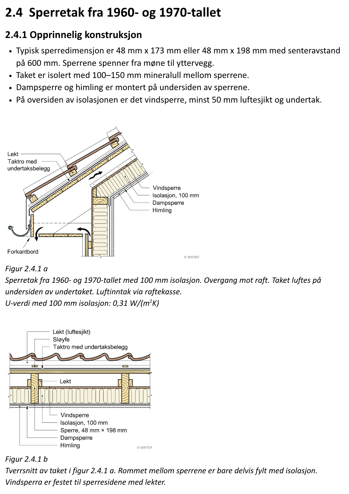

# 2.4.1 Sperretak fra 1960- og 1970-tallet: Opprinnelig konstruksjon

_Rafter roofs from the 1960s and 1970s: Original construction_

## Picture

## Norwegian text

### 2.4 Sperretak fra 1960- og 1970-tallet

#### 2.4.1 Opprinnelig konstruksjon

- Typisk sperredimensjon er 48 mm x 173 mm eller 48 mm x 198 mm med senteravstand på 600 mm. Sperrene spenner fra møne til yttervegg.
- Taket er isolert med 100–150 mm mineralull mellom sperrene.
- Dampsperre og himling er montert på undersiden av sperrene.
- På oversiden av isolasjonen er det vindsperre, minst 50 mm luftesjikt og undertak.

**Figur 2.4.1 a**
Sperretak fra 1960- og 1970-tallet med 100 mm isolasjon. Overgang mot raft. Taket luftes på undersiden av undertaket. Luftinntak via raftekasse.
U-verdi med 100 mm isolasjon: 0,31 W/(m²K)

Figure labels: Lekt · Taktro med undertaksbelegg · Forkantbord · Vindsperre · Isolasjon, 100 mm · Dampsperre · Himling

**Figur 2.4.1 b**
Tverrsnitt av taket i figur 2.4.1 a. Rommet mellom sperrene er bare delvis fylt med isolasjon. Vindsperra er festet til sperresidene med lekter.

Figure labels: Lekt (luftesjikt) · Sløyfe · Taktro med undertaksbelegg · Lekt · Vindsperre · Isolasjon, 100 mm · Sperre, 48 mm × 198 mm · Dampsperre · Himling

## English translation

### 2.4 Rafter roofs from the 1960s and 1970s

#### 2.4.1 Original construction

- Typical rafter size is 48 mm x 173 mm or 48 mm x 198 mm, spaced 600 mm centre to centre. The rafters span from the ridge to the exterior wall.
- The roof is insulated with 100–150 mm of mineral wool between the rafters.
- The vapour barrier and the ceiling are mounted on the underside of the rafters.
- On the top side of the insulation there is a wind barrier, an air gap of at least 50 mm, and a roof underlay (secondary roof).

**Figure 2.4.1 a**
Rafter roof from the 1960s and 1970s with 100 mm insulation. Transition to the eaves. The roof is ventilated on the underside of the roof underlay. Air intake through the eaves box (soffit).
U-value with 100 mm insulation: 0.31 W/(m²K)

Figure labels: Batten · Roof boarding (sarking) with underlay felt · Fascia board · Wind barrier · Insulation, 100 mm · Vapour barrier · Ceiling

**Figure 2.4.1 b**
Cross-section of the roof in figure 2.4.1 a. The space between the rafters is only partly filled with insulation. The wind barrier is fastened to the sides of the rafters with battens.

Figure labels: Batten (air gap) · Counter-batten · Roof boarding with underlay felt · Batten · Wind barrier · Insulation, 100 mm · Rafter, 48 mm × 198 mm · Vapour barrier · Ceiling

## Vocabulary

| Norwegian | English | Note |
|---|---|---|
| sperretak | rafter roof | |
| sperre (sperrene) | rafter (the rafters) | |
| senteravstand | centre-to-centre spacing (c/c) | |
| møne | ridge | |
| yttervegg | exterior wall | |
| mineralull | mineral wool | |
| dampsperre | vapour barrier | on the warm (inside) face of the insulation |
| himling | ceiling | |
| vindsperre | wind barrier | on the cold (outside) face of the insulation; see [Insulation](../insulation/insulation.md) |
| luftesjikt | air gap / ventilation layer | |
| undertak | roof underlay / secondary roof | the water-shedding layer under the tiles |
| lekt | batten | |
| sløyfe | counter-batten | |
| taktro | roof boarding / sarking | |
| undertaksbelegg | underlay felt | |
| forkantbord | fascia board | |
| raft | eaves | |
| raftekasse | eaves box / soffit | |
| U-verdi | U-value (heat loss, W/(m²K)); lower is better | |

## Q&A

_No questions yet._
