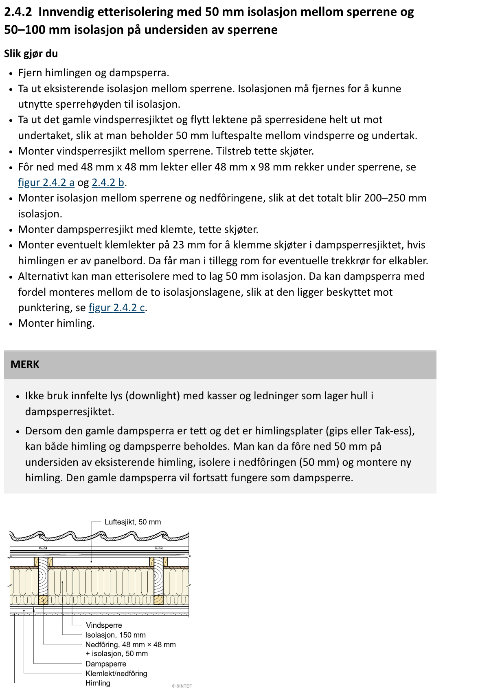
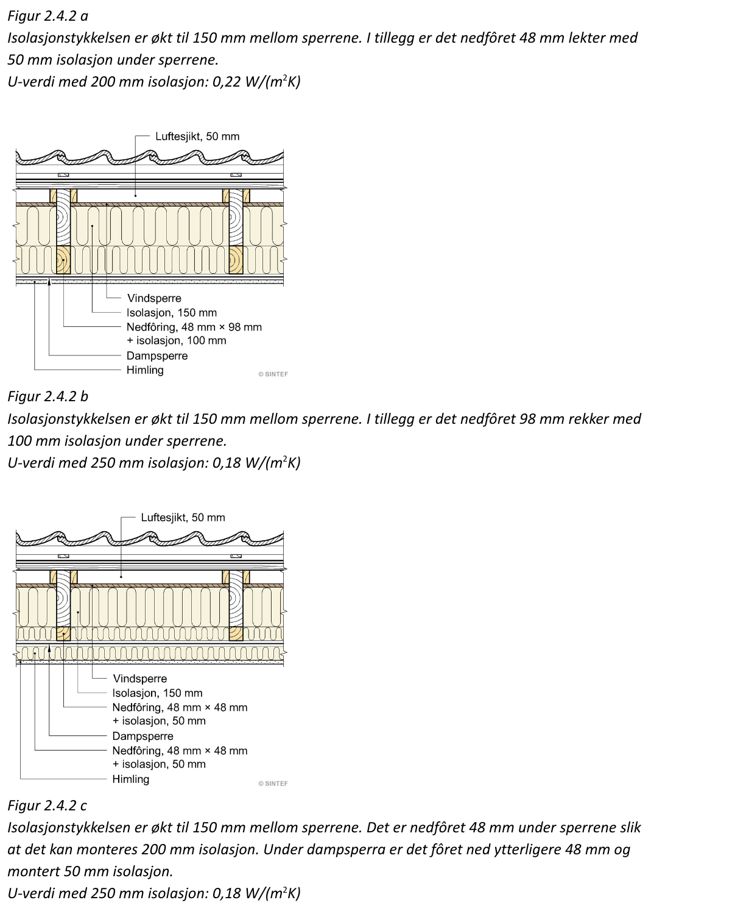

# 2.4.2 Innvendig etterisolering med 50 mm isolasjon mellom sperrene og 50–100 mm isolasjon på undersiden av sperrene

_Interior retrofit insulation with 50 mm insulation between the rafters and 50–100 mm insulation on the underside of the rafters_

Continues [2.4.1 Sperretak fra 1960- og 1970-tallet: Opprinnelig konstruksjon](2.4.1-sperretak-1960-1970.md).

## Pictures

## Norwegian text

### 2.4.2 Innvendig etterisolering med 50 mm isolasjon mellom sperrene og 50–100 mm isolasjon på undersiden av sperrene

**Slik gjør du**

- Fjern himlingen og dampsperra.
- Ta ut eksisterende isolasjon mellom sperrene. Isolasjonen må fjernes for å kunne utnytte sperrehøyden til isolasjon.
- Ta ut det gamle vindsperresjiktet og flytt lektene på sperresidene helt ut mot undertaket, slik at man beholder 50 mm luftespalte mellom vindsperre og undertak.
- Monter vindsperresjikt mellom sperrene. Tilstreb tette skjøter.
- Fôr ned med 48 mm x 48 mm lekter eller 48 mm x 98 mm rekker under sperrene, se figur 2.4.2 a og 2.4.2 b.
- Monter isolasjon mellom sperrene og nedfôringene, slik at det totalt blir 200–250 mm isolasjon.
- Monter dampsperresjikt med klemte, tette skjøter.
- Monter eventuelt klemlekter på 23 mm for å klemme skjøter i dampsperresjiktet, hvis himlingen er av panelbord. Da får man i tillegg rom for eventuelle trekkrør for elkabler.
- Alternativt kan man etterisolere med to lag 50 mm isolasjon. Da kan dampsperra med fordel monteres mellom de to isolasjonslagene, slik at den ligger beskyttet mot punktering, se figur 2.4.2 c.
- Monter himling.

**MERK**

- Ikke bruk innfelte lys (downlight) med kasser og ledninger som lager hull i dampsperresjiktet.
- Dersom den gamle dampsperra er tett og det er himlingsplater (gips eller Tak-ess), kan både himling og dampsperre beholdes. Man kan da fôre ned 50 mm på undersiden av eksisterende himling, isolere i nedfôringen (50 mm) og montere ny himling. Den gamle dampsperra vil fortsatt fungere som dampsperre.

**Figur 2.4.2 a**
Isolasjonstykkelsen er økt til 150 mm mellom sperrene. I tillegg er det nedfôret 48 mm lekter med 50 mm isolasjon under sperrene.
U-verdi med 200 mm isolasjon: 0,22 W/(m²K)

Figure labels: Luftesjikt, 50 mm · Vindsperre · Isolasjon, 150 mm · Nedfôring, 48 mm × 48 mm + isolasjon, 50 mm · Dampsperre · Klemlekt/nedfôring · Himling

**Figur 2.4.2 b**
Isolasjonstykkelsen er økt til 150 mm mellom sperrene. I tillegg er det nedfôret 98 mm rekker med 100 mm isolasjon under sperrene.
U-verdi med 250 mm isolasjon: 0,18 W/(m²K)

Figure labels: Luftesjikt, 50 mm · Vindsperre · Isolasjon, 150 mm · Nedfôring, 48 mm × 98 mm + isolasjon, 100 mm · Dampsperre · Himling

**Figur 2.4.2 c**
Isolasjonstykkelsen er økt til 150 mm mellom sperrene. Det er nedfôret 48 mm under sperrene slik at det kan monteres 200 mm isolasjon. Under dampsperra er det fôret ned ytterligere 48 mm og montert 50 mm isolasjon.
U-verdi med 250 mm isolasjon: 0,18 W/(m²K)

Figure labels: Luftesjikt, 50 mm · Vindsperre · Isolasjon, 150 mm · Nedfôring, 48 mm × 48 mm + isolasjon, 50 mm · Dampsperre · Nedfôring, 48 mm × 48 mm + isolasjon, 50 mm · Himling

## English translation

### 2.4.2 Interior retrofit insulation with 50 mm insulation between the rafters and 50–100 mm insulation on the underside of the rafters

**How to do it**

- Remove the ceiling and the vapour barrier.
- Take out the existing insulation between the rafters. The insulation must be removed so the full rafter depth can be used for insulation.
- Take out the old wind barrier layer and move the battens on the sides of the rafters all the way up against the roof underlay, so that a 50 mm air gap is kept between the wind barrier and the underlay.
- Install a wind barrier layer between the rafters. Aim for airtight joints.
- Fur down with 48 mm x 48 mm battens or 48 mm x 98 mm timbers under the rafters, see figures 2.4.2 a and 2.4.2 b.
- Install insulation between the rafters and the furring, so that the total becomes 200–250 mm of insulation.
- Install a vapour barrier layer with clamped, airtight joints.
- If the ceiling is made of panel boards, optionally install 23 mm clamping battens to clamp the joints in the vapour barrier layer. This also gives room for any conduits for electrical cables.
- Alternatively, you can retrofit with two layers of 50 mm insulation. The vapour barrier is then best installed between the two insulation layers, where it is protected against puncturing, see figure 2.4.2 c.
- Install the ceiling.

**NOTE**

- Do not use recessed lights (downlights) with housings and wiring that make holes in the vapour barrier layer.
- If the old vapour barrier is airtight and the ceiling is made of boards (plasterboard or Tak-ess), both the ceiling and the vapour barrier can be kept. You can then fur down 50 mm on the underside of the existing ceiling, insulate within the furring (50 mm) and install a new ceiling. The old vapour barrier will still work as the vapour barrier.

**Figure 2.4.2 a**
The insulation thickness between the rafters is increased to 150 mm. In addition, 48 mm battens with 50 mm of insulation are furred down under the rafters.
U-value with 200 mm insulation: 0.22 W/(m²K)

Figure labels: Air gap, 50 mm · Wind barrier · Insulation, 150 mm · Furring, 48 mm × 48 mm + insulation, 50 mm · Vapour barrier · Clamping batten/furring · Ceiling

**Figure 2.4.2 b**
The insulation thickness between the rafters is increased to 150 mm. In addition, 98 mm timbers with 100 mm of insulation are furred down under the rafters.
U-value with 250 mm insulation: 0.18 W/(m²K)

Figure labels: Air gap, 50 mm · Wind barrier · Insulation, 150 mm · Furring, 48 mm × 98 mm + insulation, 100 mm · Vapour barrier · Ceiling

**Figure 2.4.2 c**
The insulation thickness between the rafters is increased to 150 mm. The rafters are furred down 48 mm so that 200 mm of insulation can be installed. Below the vapour barrier, a further 48 mm is furred down and 50 mm of insulation installed.
U-value with 250 mm insulation: 0.18 W/(m²K)

Figure labels: Air gap, 50 mm · Wind barrier · Insulation, 150 mm · Furring, 48 mm × 48 mm + insulation, 50 mm · Vapour barrier · Furring, 48 mm × 48 mm + insulation, 50 mm · Ceiling

### Summary of the options

| Option | Below the rafters | Total insulation | U-value W/(m²K) |
|---|---|---|---|
| Original (2.4.1) | none | 100 mm | 0.31 |
| Figure 2.4.2 a | 48 × 48 furring + 50 mm | 200 mm | 0.22 |
| Figure 2.4.2 b | 48 × 98 furring + 100 mm | 250 mm | 0.18 |
| Figure 2.4.2 c | 2 × (48 × 48 furring + 50 mm), vapour barrier between the two layers | 250 mm | 0.18 |

## Vocabulary

| Norwegian | English | Note |
|---|---|---|
| etterisolering / etterisolere | retrofit insulation / to add insulation afterwards | |
| innvendig | interior, from the inside | |
| slik gjør du | how to do it (lit. "this is how you do") | |
| fjern | remove | imperative of _fjerne_ |
| eksisterende | existing | |
| utnytte | make use of | |
| sperrehøyde | rafter depth | |
| vindsperresjikt | wind barrier layer | _sjikt_ = layer |
| luftespalte | air gap (ventilation gap) | |
| skjøt (skjøter) | joint (joints), overlap | |
| tilstreb | aim for, strive for | imperative of _tilstrebe_ |
| tett | tight, airtight | |
| fôre ned / nedfôring | fur down / furring (battens fixed under the rafters to add depth) | |
| rekke (rekker) | timber member, here 48 × 98 mm | |
| dampsperresjikt | vapour barrier layer | |
| klemme / klemt | clamp / clamped | |
| klemlekt | clamping batten | holds the vapour barrier joints tight |
| panelbord | panel board (wood panelling) | |
| trekkrør | conduit (pipe to pull cables through) | |
| elkabel | electrical cable | |
| med fordel | advantageously, preferably | |
| punktering | puncture | |
| merk | note | |
| innfelte lys | recessed lights (downlights) | |
| himlingsplater | ceiling boards | |
| gips | plasterboard (gypsum board) | |
| beholde | keep | |
| isolasjonstykkelse | insulation thickness | |
| økt (øke) | increased (to increase) | |
| i tillegg | in addition | |
| ytterligere | further, additional | |

## Q&A

### What is U-value? Is smaller better?

**U-value (U-verdi)** is how much heat passes through a building part. It is measured in **W/(m²K)**: watts of heat lost through **1 m²** of the wall/roof for every **1 °C (1 K)** of temperature difference between inside and outside.

**Yes, smaller is better.** A lower U-value means less heat escapes, so the part is better insulated.

Example: a 50 m² roof, 20 °C inside and 0 °C outside (20 K difference):

| Roof | U-value | Heat loss = U × area × ΔT |
|---|---|---|
| Original, 100 mm (2.4.1) | 0.31 | 0.31 × 50 × 20 = **310 W** |
| Figure 2.4.2 a, 200 mm | 0.22 | 0.22 × 50 × 20 = **220 W** |
| Figure 2.4.2 b/c, 250 mm | 0.18 | 0.18 × 50 × 20 = **180 W** (about 40 % less than the original) |

Things to note:

- U-value is the inverse of the total thermal resistance (U = 1 / R). More insulation gives more R and a lower U, with diminishing returns: going from 100 to 200 mm cuts U by 0.09, but 200 to 250 mm only cuts it by 0.04.
- It counts heat passing through the material, not air leaking through gaps. That is why the book stresses airtight joints in the wind barrier and vapour barrier.
- For comparison, the Norwegian building code TEK17 (for new buildings) has a minimum requirement for roofs of about U ≤ 0.18, and typical new roofs are designed to around 0.13. So option b/c brings this old roof up to roughly the minimum level for a new house.
