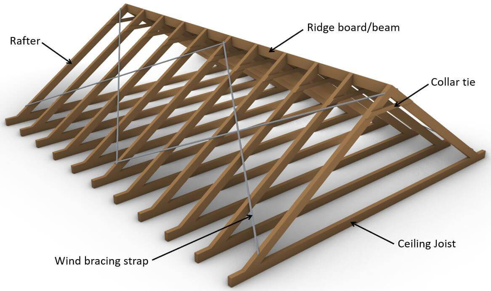

# Rafter Roof

## Components

- **Rafter**: the sloped member running from the wall plate up to the ridge.
- **Ridge board/beam**: the horizontal member at the peak that the rafters meet.
- **Collar tie**: a horizontal member that ties opposing rafters together in the upper part of the roof.
- **Ceiling joist**: a horizontal member at the base of the rafters that ties the walls together and resists outward thrust.
- **Wind bracing strap**: a diagonal strap across the rafters that braces the roof against racking.

## References

- [Rafter Roof Design – Structural Basics](https://www.structuralbasics.com/rafter-roof-design/): rafter roof design knowledge.
