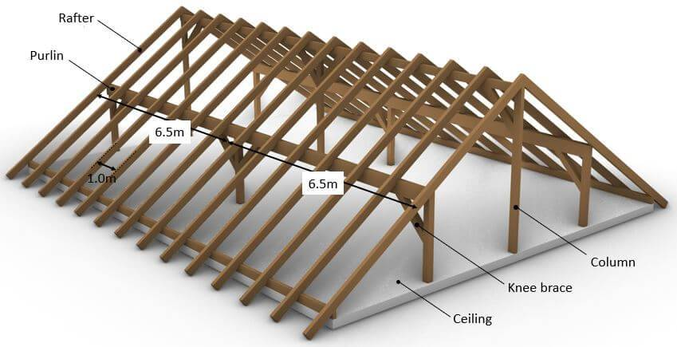

# Purlin Roof

## Components

- **Rafter**: the sloped member running from the eaves up to the ridge. The rafters rest on the purlins (spaced 1.0 m apart in the example).
- **Purlin**: the horizontal beam running along the length of the roof, parallel to the ridge, that supports the rafters partway up the slope (spans 6.5 m between columns in the example).
- **Column**: the vertical post that carries the purlin down to the structure below.
- **Knee brace**: a short diagonal member between the column and the purlin that shortens the purlin's effective span and stiffens the frame.
- **Ceiling**: the floor/ceiling structure at the base of the roof.

## References

- [Purlin Roof Design – Structural Basics](https://www.structuralbasics.com/purlin-roof-design/): purlin roof design knowledge.
