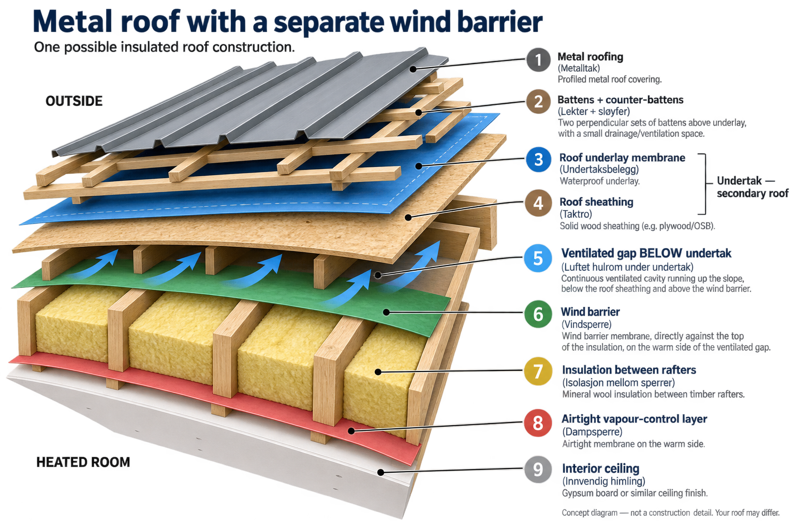

# Roof Basics

General knowledge about roofs: roof types, parts of a roof, structural members, roof layers and membranes, and attic terms.

## Example: metal roof with a separate wind barrier

One possible insulated roof construction, from outside to the heated room:

1. **Metal roofing** (metalltak): profiled metal roof covering.
2. **Battens + counter-battens** (lekter + sløyfer): two sets of battens above the underlay, leaving drainage/ventilation space.
3. **Roof underlay membrane** (undertaksbelegg): waterproof underlay.
4. **Roof sheathing** (taktro): solid wood sheathing, e.g. plywood/OSB. Layers 3 + 4 together form the **undertak** (secondary roof).
5. **Ventilated gap below the undertak** (luftet hulrom under undertak): continuous ventilated cavity running up the slope, between the sheathing and the wind barrier.
6. **Wind barrier** (vindsperre): directly against the top of the insulation, on the warm side of the ventilated gap.
7. **Insulation between rafters** (isolasjon mellom sperrer): mineral wool between the timber rafters.
8. **Airtight vapour-control layer** (dampsperre): airtight membrane on the warm side.
9. **Interior ceiling** (innvendig himling): plasterboard or similar ceiling finish.

## Terms

| Norwegian — forklaring | English — explanation | 中文 — 解释 |
|---|---|---|
| **Skråtak / skrått tak** — Tak med hellende takflater. | **Pitched roof** — A roof with sloping surfaces. | **坡屋顶** — 屋面有倾斜坡度的屋顶。 |
| **Skrått tretak** — Skråtak med bærekonstruksjon av tre. | **Pitched timber roof** — A sloping roof supported by a timber structure. | **木结构坡屋顶** — 由木构件承重的坡屋顶；外层不一定是木材。 |
| **Metalltak / metalltekking** — Tak med et ytre tekkesjikt av metall. | **Metal roof / metal roofing** — A roof whose outer covering is metal. | **金属屋顶／金属屋面** — 外层覆盖材料为金属的屋顶。 |
| **Saltak** — Tak med to skrå flater som møtes ved mønet. | **Gable roof** — Two roof slopes meeting at a ridge. | **双坡屋顶** — 两个坡面在屋脊处相交的屋顶。 |
| **Pulttak** — Tak med én skrå takflate. | **Single-pitch / shed roof** — A roof with one sloping surface. | **单坡屋顶** — 只有一个坡面的屋顶。 |
| **Møne** — Den øverste linjen der to takflater møtes. | **Ridge** — The highest line where two roof slopes meet. | **屋脊** — 两个屋顶坡面在最高处相交形成的线。 |
| **Takfot / raft** — Takets nederste kant, vanligvis ved takrennen. | **Eaves** — The lower roof edge, often extending beyond the wall. | **屋檐／檐口** — 屋顶坡面的下缘，通常伸出外墙。 |
| **Takutstikk** — Den delen av taket som stikker utenfor ytterveggen. | **Roof overhang** — The part of a roof extending beyond the outside wall. | **屋顶挑檐／出檐** — 屋顶超出外墙的部分。 |
| **Loft / loftsrom** — Rommet under taket og over etasjen nedenfor. | **Attic / attic space** — The space beneath the roof and above the floor below. | **阁楼／阁楼空间** — 位于屋顶下方、下层楼板上方的空间。 |
| **Kaldt loft / kaldloft** — Uoppvarmet loft utenfor boligens varmeisolerte del. | **Cold attic** — An unheated attic outside the insulated living space. | **冷阁楼** — 位于住宅保温范围之外、不供暖的阁楼。 |
| **Oppvarmet loftsrom** — Loft som inngår i den oppvarmede delen av huset. | **Heated attic / warm attic** — An attic included within the heated interior. | **供暖阁楼／暖阁楼** — 纳入室内供暖和保温范围的阁楼。 |
| **Uoppvarmet / uisolert** — Uten oppvarming / uten varmeisolasjon. | **Unheated / uninsulated** — Without heating / without thermal insulation. | **不供暖／未保温** — 没有供暖／没有设置保温层；两者含义不同。 |
| **Ventilert / luftet** — Utformet slik at luft kan strømme gjennom. | **Ventilated** — Arranged to allow air to move through a space. | **通风的** — 允许空气通过、流动的。 |
| **Himling / skrå himling** — Innvendig takflate / en innvendig takflate som heller. | **Ceiling / sloping ceiling** — The interior overhead surface / one that slopes. | **天花板／斜天花板** — 室内顶部表面／倾斜的室内顶部表面。 |
| **Halvannenetasjes bolig** — Bolig med en øvre etasje delvis innenfor skråtaket. | **One-and-a-half-storey house** — A house whose upper floor is partly within the roof. | **一层半住宅** — 上层部分空间位于坡屋顶内部的住宅。 |
| **Taksperre / sperre** — Skrå bjelke som bærer taket i takets fallretning. | **Rafter** — A sloping structural member running down the roof slope. | **椽子／屋顶斜梁** — 顺着屋顶坡度设置的承重构件。 |
| **Takås / ås** — Bjelke langs taket, vanligvis parallelt med mønet. | **Purlin** — A roof-supporting beam generally parallel to the ridge. | **檩条** — 通常与屋脊平行、支撑屋面的梁。 |
| **Bjelke** — Bærende konstruksjonsdel som overfører last til støttene. | **Beam** — A structural member carrying loads to its supports. | **梁** — 将荷载传递到支撑处的承重构件。 |
| **Takstol** — Sammensatt rammeverk som bærer taket, ofte med trekanter. | **Roof truss** — A structural framework, often triangulated, supporting the roof. | **屋架** — 由多个构件连接组成、通常包含三角形的屋顶承重框架。 |
| **Fagverk** — Konstruksjon av sammenkoblede staver, vanligvis i trekantmønster. | **Truss** — A framework of connected members, usually forming triangles. | **桁架** — 由杆件组成、通常采用三角形组合的承重结构。 |
| **Loftsromstakstol / A-takstol** — Takstol med plass til et rom inne i konstruksjonen. | **Attic truss / room-in-roof truss** — A truss designed to leave usable room space inside. | **阁楼屋架／A型屋架** — 内部留有可使用阁楼空间的屋架。 |
| **Bærende konstruksjon** — Bygningsdeler som bærer og overfører last. | **Load-bearing structure** — Parts of a building that support and transfer loads. | **承重结构** — 承受并传递建筑荷载的构件系统。 |
| **Sperrehøyde** — Sperrens tverrsnittshøyde, som påvirker tilgjengelig isolasjonsdybde. | **Rafter depth** — The rafter’s cross-sectional depth, affecting space available for insulation. | **椽子截面高度／斜梁厚度** — 影响椽间可放置保温材料厚度的尺寸。 |
| **Taktekking** — Det ytterste laget som beskytter taket mot været. | **Roof covering / roofing** — The outer weather-protective covering, such as metal or tiles. | **屋面覆盖层** — 最外侧抵御风雨的材料，如金属板或瓦。 |
| **Lekt; lekter** — Smale trestykker som taktekkingen festes til, vanligvis på tvers av takfallet. | **Batten; battens** — Narrow strips, usually across the slope, supporting the roof covering. | **挂瓦条／横向屋面条** — 通常横跨坡面，用于固定和支撑屋面材料的细木条。 |
| **Sløyfe; sløyfer** — Lekter langs takfallet som skaper avstand for lufting og drenering. | **Counter-batten; counter-battens** — Strips running down the slope, creating ventilation and drainage space. | **顺水条／纵向垫条** — 顺着坡面设置，为通风和排水留出空间的木条。 |
| **Luftespalte / luftesjikt** — Åpent mellomrom som gir plass til luftstrøm. | **Ventilation gap / ventilated cavity** — An open passage for airflow. | **通风空隙／通风层** — 供空气流动的空腔。 |
| **Undertak** — Sekundært beskyttende sjikt under taktekkingen som leder bort inntrengt vann. | **Secondary roof / roof underlay system** — A protective layer or assembly beneath the outer covering that drains water getting through it. | **副屋面／屋面防水基层系统** — 外层屋面下方的第二道保护，可由板材和防水垫层组成，也可采用合适的膜系统。 |
| **Undertaksbelegg / underlagsbelegg** — Beskyttende belegg under taktekkingen, ofte lagt på taktro. | **Roofing underlay / underlay membrane** — A protective sheet beneath the roof covering, often supported by sheathing. | **屋面防水垫层／防水膜** — 位于外层屋面下方、承接并排走渗入水的薄层材料。 |
| **Taktro** — Sammenhengende bord eller plater som danner et underlag i taket. | **Roof sheathing / roof decking** — Continuous boards or panels forming the roof deck. | **屋面板／屋面基层板** — 铺在屋顶骨架上的连续木板或板材。 |
| **Taktro med undertaksbelegg** — Takbord eller plater med et beskyttende belegg oppå. | **Roof sheathing with underlay** — A solid roof deck with a protective membrane on top. | **屋面板加防水垫层** — 实体板材上方铺设防水垫层的组合。 |
| **Membran** — Et tynt sjikt med en bestemt beskyttende eller tettende funksjon. | **Membrane** — A thin layer with a particular protective or sealing function. | **膜／薄膜层** — 起防水、防风或隔汽等特定作用的薄层；不同膜功能不同。 |
| **Vindsperre** — Lufttettende sjikt på utsiden av isolasjonen, vanligvis diffusjonsåpent. | **Wind barrier** — A layer outside the insulation that limits wind penetration, usually allowing vapour to escape. | **防风层** — 位于保温层外侧，防止风穿透保温材料，通常允许水蒸气向外扩散。 |
| **Kombinert undertak og vindsperre** — Ett egnet sjikt som fungerer både som undertak og vindsperre. | **Combined underlay and wind barrier** — One suitable layer performing both functions. | **防水、防风合一层** — 同时承担副屋面防水与保温层防风作用的材料层。 |
| **Dampsperre** — Sjikt med høy vanndampmotstand, vanligvis på varm side av isolasjonen. | **Vapour barrier** — A high vapour-resistance layer, usually on the warm side of insulation. | **隔汽层** — 通常位于保温层暖侧，具有较高水蒸气阻力的材料层。 |
| **Dampbrems / dampkontrollsjikt** — Sjikt som begrenser vanndamptransport; motstanden kan variere. | **Vapour retarder / vapour-control layer** — A layer controlling vapour movement; its resistance depends on the product. | **限汽层／水蒸气控制层** — 限制水蒸气通过的材料层，阻力因产品而异。 |
| **Forkantbord** — Bord ved takfoten, ofte bak takrennen. | **Fascia board** — The board at the roof edge, often behind the gutter. | **檐口封板** — 位于屋檐边缘、通常在排水天沟后方的板。 |
| **Takrenne** — Renne som samler og leder bort regnvann fra taket. | **Gutter** — A channel collecting and carrying away roof rainwater. | **檐沟／雨水槽** — 收集并排走屋面雨水的槽。 |

## Related notes

- [Rafter Roof](rafter-roof.md)
- [Purlin Roof](purlin-roof.md)
- [Roof Battens](roof-battens.md)
