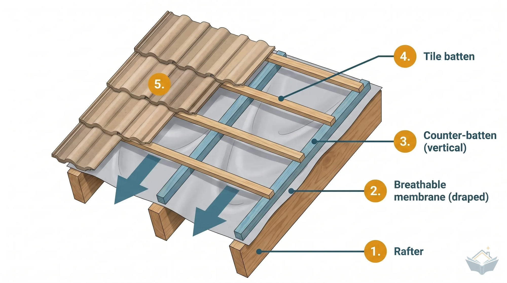

# Roof Battens and Counter-Battens

## Roof layers

From the structure outward:

1. **Rafter**: the sloped structural member of the roof.
2. **Breathable membrane (draped)**: laid over the rafters with a slight sag between them, so any water that gets past the tiles runs down to the eaves (see the arrows).
3. **Counter-batten (vertical)**: fixed on top of the membrane along each rafter, running from eaves to ridge. It lifts the tile battens off the membrane, leaving a gap for ventilation and drainage.
4. **Tile batten**: horizontal battens fixed across the counter-battens, parallel to the ridge. The tiles hang on these.
5. **Roof tiles**: the outer covering, hung on the tile battens.

## References

- [Counter battens – BuildWiz](https://www.buildwiz.uk/knowledge/materials/roofing/counter-battens): more details on counter-battens.
